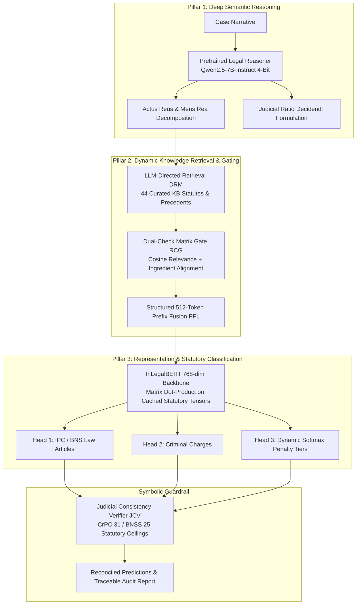

# ⚖️ DLKR-LJP: Dynamic Legal Knowledge Retrieval for Legal Judgment Prediction

## Complete System Architecture & Operational Workflow
**Document Version:** 3.0  
**Target Codebase:** `standalone_dlkr_ljp (3).py`  
**Legal Framework:** Indian Penal Jurisprudence — Indian Penal Code (IPC 1860) & Bharatiya Nyaya Sanhita (BNS 2023)  
**Hardware Targets:** Google Colab GPU (CUDA T4 / A100) with High-Speed CPU Fallback  

---

## 1. Executive Summary & Core Design Philosophy

**DLKR-LJP** is a Neuro-Symbolic Legal Judgment Prediction (LJP) architecture designed specifically for Indian criminal jurisprudence. Traditional LJP systems suffer from two major flaws:
1. **Keyword Overfitting & Surface Bias:** Naive neural text encoders misinterpret casual words (e.g., treating *"secretly took mobile phone"* as robbery, or *"unpaid commercial invoice"* as cheating).
2. **Statutory Hallucination:** Black-box language models can invent non-existent provisions or assign penalties that violate statutory ceilings under Section 31 of the Code of Criminal Procedure (CrPC).

`standalone_dlkr_ljp (3).py` resolves these failures by implementing a **Tri-Pillar Neuro-Symbolic Architecture**:



---

## 2. Mathematical Formalization & Pipeline Stages

### Stage 1: Pretrained Legal Fact Comprehension & Reasoning
* **Module:** `PretrainedLegalReasoner` (Lines 1443–1580)
* **Execution Engine:**
  * **GPU Mode (CUDA Available):** 4-Bit quantized `Qwen/Qwen2.5-7B-Instruct` using `BitsAndBytesConfig(load_in_4bit=True, bnb_4bit_compute_dtype=torch.float16, bnb_4bit_quant_type="nf4")`.
  * **CPU Mode (Fallback):** Dense Semantic Prober using normalized TF-IDF proposition dot-products against canonical Supreme Court definitions.
* **Responsibilities:**
  1. **Scoped Negation Resolution:** Evaluates contextual qualifiers (e.g., `accused_unarmed` vs `victim_unarmed`, `no force used` negating robbery into simple theft).
  2. **Substantive Ingredient Extraction:**
     $$\mathbf{F}_{\text{atomic}} = \{\text{Actus Reus}, \text{Mens Rea}, \text{Injury Severity}, \text{Weapon}, \text{Premeditation}, \text{Civil Disputation}\}$$
  3. **Judicial Ratio Decidendi Generation:** Outputs a formal, precedent-anchored legal rationale citing applicable Supreme Court standards.

---

### Stage 2: Dynamic Legal Knowledge Retrieval (DRM)
* **Module:** `DynamicLegalKnowledgeRetriever` (Lines 1850–2050)
* **Knowledge Repository:** 44 Curated Knowledge Base entries (20 IPC/BNS statutes, 11 Supreme Court precedents, and 13 legal concepts).
* **LLM-Directed Querying:**
  Rather than querying solely with raw case text, the retriever augments the query with the LLM's extracted legal concepts:
  $$\mathbf{Q}_{\text{enriched}} = \mathbf{T}_{\text{fact}} \cup \{\text{Primary Charge}, \text{Actus Reus}, \text{Mens Rea}, \text{Weapon Category}\}$$
* **Retrieval Mechanisms:**
  * Primary: Dense ChromaDB HNSW Cosine Index.
  * Fallback: Scoped stem groups with strict word boundary regex matching (`\b`), preventing substring collisions (e.g., preventing *"bus passenger"* from matching *"burglary"*, or *"taxes"* from matching *"axe"*).

---

### Stage 3: Relevance & Confidence Gating Layer (RCG)
* **Module:** `RelevanceAndConfidenceGate` (Lines 2055–2230)
* **Dual-Check Matrix Evaluation:**
  Every retrieved statutory candidate $k_i$ must pass two orthogonal tests:
  1. **Semantic Cosine Relevance:**
     $$\text{Sim}_{\text{cosine}}(\mathbf{T}_{\text{fact}}, k_i) \ge \tau \quad (\tau = 0.40)$$
  2. **Statutory Ingredient Alignment Score ($S_{\text{ingredient}}$):**
     Evaluates whether the extracted atomic facts fulfill the *essential legal ingredients* of the statute:
     $$S_{\text{ingredient}}(k_i) = \frac{|\mathbf{F}_{\text{matched ingredients}}|}{|\mathbf{F}_{\text{statutory requirements}}|}$$
* **Noise Suppression:** Spurious candidates scoring below $\tau$ or lacking essential ingredients are segregated into `filtered_noise` with traceable rejection logs.

---

### Stage 4: Multi-Aspect Prefix-Based Attention Knowledge Fusion (PFL)
* **Module:** `PrefixKnowledgeFusion` (Lines 2235–2330)
* **Token Budget Allocation:**
  InLegalBERT enforces a strict positional context limit of 512 tokens. To prevent truncation of crucial legal sections, the input sequence is structured into budgeted segments:

| Segment | Content | Token Budget | Character Limit |
| :--- | :--- | :---: | :---: |
| **`[LEGAL_RATIO]`** | LLM Ratio Decidendi, Actus Reus, Mens Rea | ~128 tokens | ~450 chars |
| **`[STATUTORY_PREFIX]`** | Top 2–3 Gated Statutes & Essential Ingredients | ~128 tokens | ~450 chars |
| **`[FACT_ASPECTS]`** | Weapon Category, Injury Grade, Property Action | ~64 tokens | ~200 chars |
| **`[CASE_FACTS]`** | Core Factual Record of the Case | ~192 tokens | ~900 chars |

$$\mathbf{S}_{\text{fused}} = \text{Concat}(\text{Prefix}_{\text{Ratio}}, \text{Prefix}_{\text{Statute}}, \text{Prefix}_{\text{Aspects}}, \text{Text}_{\text{Facts}})$$

---

### Stage 5: Multi-Head Prediction Network (MHPN)
* **Module:** `MultiTaskLegalPredictor` (Lines 2335–2780)
* **Backbone:** `law-ai/InLegalBERT` (768-dimensional transformer encoder).
* **Statutory Vector Caching (F-20 Optimization):**
  At initialization, InLegalBERT pre-computes and caches normalized 768-dim CLS representations for all 20 configured statutes and 13 charges:
  $$\mathbf{V}_{\text{art}} = \{\mathbf{v}_1, \mathbf{v}_2, \dots, \mathbf{v}_{20}\}, \quad \|\mathbf{v}_i\|_2 = 1$$
* **Inference Pass:**
  A single forward pass over $\mathbf{S}_{\text{fused}}$ generates the normalized case representation $\mathbf{h}_{\text{case}}$. Similarities are calculated via instantaneous matrix dot-product:
  $$\text{Sim}_{\text{BERT}}(i) = \mathbf{h}_{\text{case}} \cdot \mathbf{v}_i^\top$$

#### Prediction Heads:
1. **Head 1: Law Articles (IPC 1860 & BNS 2023):**
   Combines baseline legal prior, gated ingredient alignment, and InLegalBERT cosine similarity:
   $$P(\text{Article}_i) = \alpha \cdot P_{\text{prior}} + \beta \cdot S_{\text{ingredient}} + \gamma \cdot \text{Sim}_{\text{BERT}}(i)$$
   *Masking Rule:* Legally impossible provisions (e.g., murder when victim survived without injury) are masked to 0.01.
2. **Head 2: Criminal Charges:**
   Maps predicted provisions to the 13 canonical criminal charge categories.
3. **Head 3: Penalty Severity Tiers:**
   Computes a dynamic softmax distribution over 4 punishment brackets anchored to the statutory ceiling of the top verified conviction provision:
   * **Tier 1:** Up to 3 Years (Bailable / Minor Misdemeanor)
   * **Tier 2:** 3 to 7 Years (Arnesh Kumar Threshold / Medium Penalty)
   * **Tier 3:** 7 to 10 Years (Serious Offence / Substantial Imprisonment)
   * **Tier 4:** Life Imprisonment / Capital Sentence (Heinous Offence)

---

### Stage 6: Judicial Consistency Verifier (JCV)
* **Module:** `JudicialConsistencyVerifier` (Lines 2785–3040)
* **Symbolic Guardrail Functions:**
  1. **Statutory Ceiling Enforcement:** Under Section 31 CrPC / Section 25 BNSS, cumulative sentences cannot exceed statutory maximums.
  2. **Exception 4 Re-Ranking:** If sudden quarrel / heat of passion without premeditation is established (Exception 4 to Section 300 IPC), Tier 4 life imprisonment is lowered to Tier 3 under Section 304 Part II.
  3. **Non-Mutating Deep-Copy Audit:** Clones prediction dictionaries without caller mutation and sorts penalty tiers in strict descending probability order.
  4. **Judicial Consistency Index (JCI):** Computes a dynamic score reflecting statutory compliance:
     $$\text{JCI} = 100.0 - \sum \text{Deductions}_{\text{violation}}$$

---

## 3. Legal Taxonomy & Statutory Mapping

| IPC Section | BNS Equivalent | Canonical Charge Category | Statutory Ceiling Bracket |
| :--- | :--- | :--- | :--- |
| **Section 302** | BNS Section 103 | Murder & Culpable Homicide | Tier 4 (Life Imprisonment / Capital) |
| **Section 304 Part I** | BNS Section 105 | Murder & Culpable Homicide | Tier 4 (Life Imprisonment) |
| **Section 304 Part II** | BNS Section 105 | Culpable Homicide (Sudden Fight) | Tier 3 (Up to 10 Years) |
| **Section 307** | BNS Section 109 | Attempt to Murder | Tier 4 (Up to Life Imprisonment) |
| **Section 323** | BNS Section 115 | Assault & Grievous Hurt | Tier 1 (Up to 1 Year) |
| **Section 324** | BNS Section 117 / 118(1) | Assault & Grievous Hurt | Tier 1 (Up to 3 Years) |
| **Section 326** | BNS Section 118(2) | Assault & Grievous Hurt | Tier 4 (Up to Life Imprisonment) |
| **Section 379** | BNS Section 303(2) | Theft & Property Offences | Tier 1 (Up to 3 Years) |
| **Section 392** | BNS Section 309(4) | Theft & Property Offences (Robbery) | Tier 3 (Up to 10 Years / 14 Years Highway) |
| **Section 406** | BNS Section 316 | Criminal Breach of Trust | Tier 1 (Up to 3 Years) |
| **Section 420** | BNS Section 318 | Cheating & Financial Fraud | Tier 2 (Up to 7 Years) |
| **Section 467** | BNS Section 338 | Forgery & Counterfeiting | Tier 4 (Up to Life Imprisonment) |
| **Section 468** | BNS Section 336 | Forgery & Counterfeiting | Tier 2 (Up to 7 Years) |
| **Section 471** | BNS Section 340 | Forgery & Counterfeiting | Tier 2 (Tracks Original Instrument) |
| **Section 376** | BNS Section 64 | Sexual Offences & Assault | Tier 4 (Rigorous 10 Years to Life) |
| **Section 498A** | BNS Section 85 | Matrimonial Cruelty & Harassment | Tier 1 (Up to 3 Years) |
| **Section 304B** | BNS Section 80 | Dowry Death | Tier 3 / Tier 4 (Min 7 Years to Life) |
| **Section 506** | BNS Section 351 | Criminal Intimidation | Tier 1 (Tier 2 if Death Threat) |
| **Section 34** | BNS Section 3 | Joint Liability (Common Intention) | Tracks Principal Offence |
| **Section 120B** | BNS Section 61 | Criminal Conspiracy | Tracks Principal Offence |

---

## 4. Gradio UI Architecture & Dark-Theme Optimization

The user interface in `standalone_dlkr_ljp (3).py` (Lines 3405–3530) includes:
* **Gradio 6.0 Compatibility:** Replaces deprecated constructor parameters with runtime launch parameters.
* **Dual-Engine Transparency Card:** Displays Engine 1 (Qwen2.5-7B Ratio Decidendi) alongside Engine 2 (InLegalBERT 768-dim statutory cosine similarities).
* **Dark Mode CSS Isolation:** Uses rich CSS gradients (`linear-gradient(135deg, #064e3b, #047857)`) and explicit `color: #ffffff !important` overrides to prevent dark-mode text from washing out on light pastel cards.
* **Automatic Google Colab Public Tunneling:**
  ```python
  is_colab = "google.colab" in sys.modules or os.path.exists("/content")
  demo.queue(default_concurrency_limit=5).launch(
      server_name="0.0.0.0" if is_colab else "127.0.0.1",
      server_port=7860,
      share=is_colab or ("--share" in sys.argv),
      show_error=True
  )
  ```
  Automatically enables `share=True` on Colab to provide a public `https://...gradio.live` link while maintaining local security.

---

## 5. Execution Recipes

### A. Google Colab (GPU Acceleration)
```bash
# 1. Install dependencies
!pip install -q torch transformers bitsandbytes accelerate gradio sentence-transformers

# 2. Execute script
!python "standalone_dlkr_ljp (3).py"
```

### B. Python API (Programmatic Execution)
```python
import importlib
mod = importlib.import_module("standalone_dlkr_ljp (3)")

pipeline = mod.DynamicLjpPipeline(load_transformer=True)
result = pipeline.run("At a bus stop, a man threatens a commuter with a knife and demands their wallet...")

print("Top Article:", result["predictions"]["head1_articles"][0]["display_name"])
print("Top Charge:", result["predictions"]["head2_charges"][0]["charge_name"])
print("Penalty Tier:", result["predictions"]["primary_penalty"]["tier"])
print("Ratio Decidendi:", result["legal_reasoning"]["ratio_decidendi"])
```
