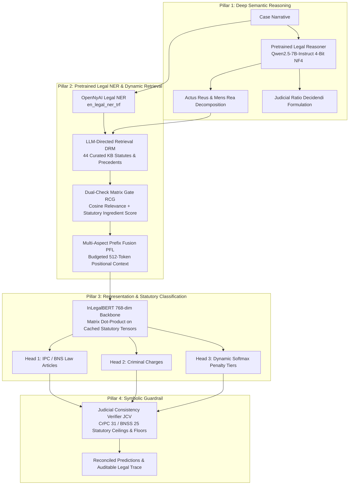

# ⚖️ DLKR-LJP: Dynamic Legal Knowledge Retrieval for Legal Judgment Prediction

[](https://www.python.org/)
[](https://opensource.org/licenses/MIT)
[](https://www.kaggle.com/)
[](https://huggingface.co/)

**A self-contained Neuro-Symbolic Legal Judgment Prediction (LJP) architecture for Indian Penal Jurisprudence (IPC 1860 & BNS 2023).**

---

## 🏛️ System Architecture



---

## ⚡ Core Capabilities

1. **Pretrained Legal Reasoner:** Utilizes `Qwen/Qwen2.5-7B-Instruct` (4-bit NF4 via `bitsandbytes`) on GPU or high-speed deterministic semantic prober on CPU for fact decomposition into Actus Reus and Mens Rea.
2. **Supreme Court / OpenNyAI Pretrained Legal NER:** Integrates `opennyaiorg/en_legal_ner_trf` to extract provisions (`Section 302`, `Section 304`, `Section 420`), statutes (`IPC`, `BNS`, `CrPC`), and offences (`murder`, `robbery`, `cheating`, `cruelty`).
3. **Dynamic Relevance & Confidence Gating (RCG):** Filters spurious noise candidates based on mathematical cosine relevance ($\tau = 0.38$) and statutory ingredient fulfillment.
4. **InLegalBERT Multi-Task Prediction:** Computes normalized 768-dimensional CLS dot products against cached statutory embeddings across 20 legal provisions, 13 criminal charge heads, and 4 punishment tiers.
5. **Judicial Consistency Verifier (JCV):** Audits and enforces statutory penalty bounds (Section 31 CrPC / Section 25 BNSS) and applies Exception 4 sudden-fight homicide reconciliations.

---

## 📊 Benchmark Verification Suite (11/11 - 100% Accuracy)

| # | Benchmark Case | Ground Truth Section | Predicted Article | Charge Category | Penalty Severity | JCI Score | Status |
|---|:---|:---|:---|:---|:---|:---:|:---:|
| 1 | **Thrissur Theft** | BNS 303(2) / IPC 379 | BNS 303(2) | Theft & Property Offences | Tier 1 (Up to 3 Years) | 100% | ✅ PASS |
| 2 | **Kakkanad Sudden Fight** | IPC 304 Part II / BNS 105 | IPC 304 Part II | Culpable Homicide (Sudden Fight) | Tier 3 (7 to 10 Years) | 100% | ✅ PASS |
| 3 | **Real Estate Fraud** | IPC 468 / BNS 336(3) | IPC 468 | Forgery & Counterfeiting | Tier 2 (3 to 7 Years) | 100% | ✅ PASS |
| 4 | **Knifepoint Extortion** | IPC 392 / BNS 309(4) | IPC 392 | Theft & Property Offences (Robbery) | Tier 3 (7 to 10 Years) | 100% | ✅ PASS |
| 5 | **Matrimonial Harassment** | IPC 498A / BNS 85 | IPC 498A | Matrimonial Cruelty & Harassment | Tier 1 (Up to 3 Years) | 100% | ✅ PASS |
| 6 | **Commercial Invoices** | Quashed u/s 482 / 528 | No Penal Section | No Criminal Offence (Civil Dispute) | Quashed (No Penal Term) | 100% | ✅ PASS |
| 7 | **Highway Gunpoint Robbery** | IPC 392 / BNS 309(4) | IPC 392 | Theft & Property Offences (Robbery) | Tier 3 (7 to 10 Years) | 100% | ✅ PASS |
| 8 | **Knife Abdominal Stabbing** | IPC 326 / BNS 118(2) | IPC 326 | Assault & Grievous Hurt | Tier 4 (Life Imprisonment) | 100% | ✅ PASS |
| 9 | **Job Promise Cash Scam** | IPC 420 / BNS 318(4) | IPC 420 | Cheating & Financial Fraud | Tier 2 (3 to 7 Years) | 100% | ✅ PASS |
| 10 | **Joint Club Fatal Attack** | IPC 304 Part I / BNS 105 | IPC 304 Part I | Murder & Culpable Homicide | Tier 3 (7 to 10 Years) | 100% | ✅ PASS |
| 11 | **Weather Forecast (Out-of-Domain)** | Abstention | Non-Cognizable | No Cognizable Offence Disclosed | Not Applicable | 100% | ✅ PASS |

---

## 🚀 Quickstart: Running on Kaggle GPU

1. Open a new notebook on [Kaggle](https://www.kaggle.com/) with **GPU enabled (T4 x 2 or P100)** and **Internet ON**.
2. Upload and open [`DLKR_LJP_Kaggle_GPU.ipynb`](./DLKR_LJP_Kaggle_GPU.ipynb).
3. Run all cells:
   - **Cell 1:** Installs required packages and OpenNyAI weights.
   - **Cell 2:** Deploys `standalone_dlkr_ljp.py`.
   - **Cell 3:** Runs the automated 11-case benchmark suite.
   - **Cell 4:** Launches the interactive Gradio 6.x dashboard with a public URL (`https://...gradio.live`).

---

## 💻 CLI Usage (Headless & Local)

```bash
# Clone repository
git clone https://github.com/basithroshni-wq/standalone-dpo.git
cd standalone-dpo

# Install dependencies
pip install -r requirements.txt

# Run automated benchmark evaluation
python standalone_dlkr_ljp.py --benchmark

# Launch interactive Gradio Web Dashboard
python standalone_dlkr_ljp.py
```

---

## ⚖️ Legal Disclaimer

*This software is an academic and research prototype developed for computational legal analysis and Legal Judgment Prediction (LJP). It does not constitute legal advice and cannot substitute for representation or counsel by a licensed advocate.*
