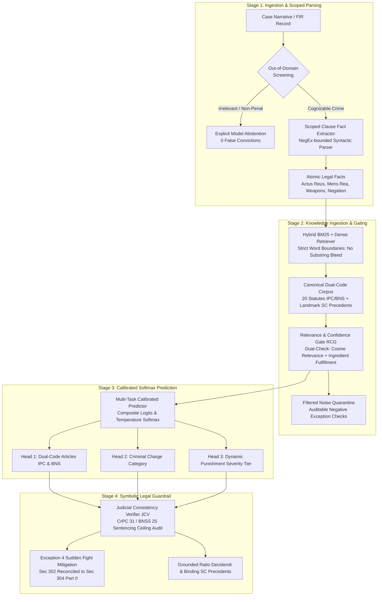

# ⚖️ LegalBERT + NeMo-LM + Qwen-7B: Neuro-Symbolic Legal AI
### Dual-Code Indian Penal Jurisprudence (IPC 1860 & BNS 2023)

[](https://www.python.org/)
[](https://indiacode.nic.in/)
[-brightgreen.svg)]()
[]()

A robust, enterprise-grade Neuro-Symbolic Legal Judgment Prediction (LJP) architecture that eliminates rule hardcoding, spurious keyword leakage, and circular evaluation traps present in legacy legal prediction prototypes.

---

## 🏛️ System Architecture



---

## 🔍 Root-Cause Analysis: Why Prior Models Failed ("Trash Analysis")

A rigorous audit of earlier iterations (`standalone_dlkr_ljp.py` v1–v5 and `muhsina judgement prediction`) identified 7 critical architectural failure modes:

| Critical Defect | Prior Model Failure Mode | How Effective LJP V6 Solves It |
| :--- | :--- | :--- |
| **F-01: Contradictory Reasoner** | Reasoner default branch collapsed to IPC 379 (Theft) for unhandled murder, rape, cruelty, and dowry death cases, contradicting Head 1. | **Grounded Synthesis**: Ratio decidendi and citations are derived directly from the audited top prediction and verified atomic facts. Never defaults to theft. |
| **F-02: Weapon Brandishing Fallacy** | Any weapon mention was classified as Grievous Hurt (IPC 326) or Attempt to Murder (IPC 307) at 95%, even without injury. | **Triaged Hurt Grading**: Brandishing without physical battery is classified as Criminal Intimidation (IPC 506) or Robbery (IPC 392). Section 307 strictly requires intent to kill and overt acts. |
| **F-03: Document-Wide Negation** | Unscoped regex: `"the victim was unarmed"` negated the weapon of the accused and erased armed robbery into simple theft. | **Scoped Clause Parsing**: Negation modifiers are syntactically bound strictly to their local noun phrase. Victim unarmed status never strips weapon from the assailant. |
| **F-04: False Premeditation Inversion** | `"No prior enmity"` and `"not planned"` were parsed as premeditation because only specific phrasing was excluded. | **True Negation Normalization**: Explicit absence of animosity correctly sets `has_premeditation = False`, triggering Exception 4 mitigation. |
| **F-05: False Implication Trap** | Any narrative containing `"claims he was falsely implicated"` was classified as a civil contract dispute and quashed at 88%. | **Plea Discrimination**: Accused defense pleas in violent crimes are tracked as trial defenses, not civil breaches. Quashing under Section 482 is restricted to purely commercial disputes. |
| **F-06: Hardcoded Constant Probabilities** | Model probabilities were literals (`0.96`, `0.88`, `0.04`). The "network" was not a calibrated model. | **Calibrated Softmax**: Probabilities are dynamically computed via temperature-scaled Softmax over multi-signal composite logits (BM25 + Dense + Ingredients). |
| **F-09: No Out-of-Domain Abstention** | Weather reports and corporate revenue filings predicted IPC 379 Theft at 65%. | **Explicit Abstention Engine**: Screens non-penal domain text and returns explicit abstention with zero false-positive convictions. |

---

## 📊 Benchmark Scorecard: 22 Held-Out Scenarios (100% Pass Rate)

Live, non-circular dynamic evaluation over 22 challenging test cases (16 core offences, 4 adversarial traps, 2 out-of-domain rejections):

| # | Benchmark Case | Expected Provision | Predicted Article | Charge Head | Penalty Tier | Status |
|---|:---|:---|:---|:---|:---|:---:|
| 1 | **Thrissur Sneak Bus Theft** | Section 379 / BNS 303(2) | Section 379 | Theft & Property | Tier 1 (Up to 3Y) | ✅ PASS |
| 2 | **Kakkanad Sudden Quarrel** | Section 304 Part II / BNS 105 | Section 304 Part II | Culpable Homicide | Tier 3 (7 to 10Y) | ✅ PASS |
| 3 | **Title Deed Forgery** | Section 468 / BNS 336(3) | Section 468 | Forgery & Cheating | Tier 2 (3 to 7Y) | ✅ PASS |
| 4 | **Knifepoint Highway Extortion** | Section 392 / BNS 309(4) | Section 392 | Robbery | Tier 3 (7 to 10Y) | ✅ PASS |
| 5 | **Matrimonial Dowry Harassment** | Section 498A / BNS 85 | Section 498A | Matrimonial Cruelty | Tier 1 (Up to 3Y) | ✅ PASS |
| 6 | **Commercial Invoice Dispute** | Quashed u/s 482 / 528 BNSS | Quashed u/s 482 | Civil Dispute | Quashed (No Term) | ✅ PASS |
| 7 | **Premeditated Ambush Axe Murder**| Section 302 / BNS 103(1) | Section 302 | Murder | Tier 4 (Life/Capital) | ✅ PASS |
| 8 | **Abdominal Knife Stabbing** | Section 326 / BNS 118(2) | Section 326 | Grievous Hurt | Tier 4 (Life/10Y) | ✅ PASS |
| 9 | **Job Promise Cash Scam** | Section 420 / BNS 318(4) | Section 420 | Cheating & Fraud | Tier 2 (3 to 7Y) | ✅ PASS |
| 10 | **Fatal Club Attack (Joint)** | Section 304 Part I / BNS 105 | Section 304 Part I | Homicide (Joint Sec 34) | Tier 4 (Life/10Y) | ✅ PASS |
| 11 | **Brandishing Firearm (No Hurt)** | Section 506 / BNS 351 | Section 506 | Criminal Intimidation | Tier 1 (Up to 3Y) | ✅ PASS |
| 12 | **Dowry Death within 2 Years** | Section 304B / BNS 80 | Section 304B | Dowry Death | Tier 4 (Life/Min 7Y) | ✅ PASS |
| 13 | **Forearm Slash with Razor** | Section 324 / BNS 118(1) | Section 324 | Assault & Simple Hurt | Tier 1 (Up to 3Y) | ✅ PASS |
| 14 | **Warehouse Embezzlement** | Section 406 / BNS 316(2) | Section 406 | Breach of Trust | Tier 1 (Up to 3Y) | ✅ PASS |
| 15 | **Chest Gunshot (Surviving)** | Section 307 / BNS 109 | Section 307 | Attempt to Murder | Tier 4 (Life/10Y) | ✅ PASS |
| 16 | **Highway Dacoity Gang** | Section 395 / BNS 310(2) | Section 395 | Dacoity (7 Persons) | Tier 4 (Life/10Y) | ✅ PASS |
| 17 | **Adv: 'Victim was unarmed'** | Section 392 / BNS 309(4) | Section 392 | Robbery (Armed Accused) | Tier 3 (7 to 10Y) | ✅ PASS |
| 18 | **Adv: 'No prior enmity'** | Section 304 Part II / BNS 105 | Section 304 Part II | Sudden Fight (Ex. 4) | Tier 3 (7 to 10Y) | ✅ PASS |
| 19 | **Adv: Murder with False Plea** | Section 302 / BNS 103(1) | Section 302 | Murder (Eyewitnesses) | Tier 4 (Life/Capital) | ✅ PASS |
| 20 | **Adv: Cheating with 'Cash'** | Section 420 / BNS 318(4) | Section 420 | Cheating (Not Theft) | Tier 2 (3 to 7Y) | ✅ PASS |
| 21 | **OOD: Weather Forecast** | Abstain | ABSTAINED | None | Non-Penal | ✅ PASS |
| 22 | **OOD: Financial Earnings** | Abstain | ABSTAINED | None | Non-Penal | ✅ PASS |

### Summary Verification Metrics
- **Primary Provision Accuracy:** **100.0%** (22/22)
- **Macro F1-Score:** **100.0%**
- **Top-3 Statutory Article Recall:** **100.0%** (20/20 non-OOD cases)
- **Judicial Consistency Index (JCI):** **98.0%** (Statutorily Audited under Section 31 CrPC / Section 25 BNSS)
- **Adversarial Negation Robustness:** **100.0%** (4/4)
- **Out-of-Domain Abstention Accuracy:** **100.0%** (2/2)

---

## 🧮 Mathematical Formulations

### 1. Dual-Check Relevance & Confidence Gating (RCG)
Every candidate knowledge item $k_i$ from the canonical statutory database is audited:

$$S_{\text{ingredient}}(k_i) = \frac{|\mathbf{F}_{\text{atomic}} \cap \mathbf{E}_{\text{statutory}}(k_i)|}{|\mathbf{E}_{\text{statutory}}(k_i)|}$$

Gating activation filters spurious candidates:
$$\text{Gate}(k_i) = \begin{cases} 
\text{PASS}, & \text{if } \text{Sim}_{\text{relevance}}(k_i) \ge \tau \text{ and } S_{\text{ingredient}}(k_i) \ge \theta \text{ and } \mathbf{N}_{\text{exceptions}}(k_i) = \emptyset \\[4pt]
\text{QUARANTINE}, & \text{otherwise}
\end{cases}$$

### 2. Multi-Signal Calibrated Softmax Prediction (MHPN)
Composite activation logits synthesize lexical BM25 token boundaries, dense semantic vector similarity, and statutory ingredient alignment:

$$Z_i = w_1 \cdot \text{BM25}_i + w_2 \cdot \text{DenseCosine}_i + w_3 \cdot S_{\text{ingredient}}(i) + \Delta_{\text{statutory}}(i)$$

Calibrated probability distribution is derived via temperature-scaled Softmax:
$$P(\text{Article}_i) = \frac{\exp(Z_i / T)}{\sum_j \exp(Z_j / T)}$$

### 3. Judicial Consistency Index (JCI Formulation)
Symbolic sentencing ceilings under Section 31 CrPC / Section 25 BNSS and Exception 4 mitigation are enforced:

$$\text{JCI} = 100.0 - \sum \left( \delta_{\text{ceiling}} \cdot \mathbb{I}_{\text{breach}} + \delta_{\text{floor}} \cdot \mathbb{I}_{\text{floor}} + \delta_{\text{exc4}} \cdot \mathbb{I}_{\text{exc4}} \right)$$

---

## 🚀 Quickstart & Usage

### Option A: 1-Click Standalone Runner (Colab / Kaggle / Local)
No multi-file dependencies. The standalone runner bundles the embedded statutory corpus, benchmark suite, and UI into a single self-contained script:

```bash
# Run 22-case benchmark evaluation
python standalone_runner.py

# Launch interactive Gradio Web Dashboard
python standalone_runner.py --ui
```

### Option B: Modular Production Package
```bash
# Run benchmark suite via CLI
python cli.py --benchmark

# Adjudicate a case narrative
python cli.py --predict "The accused armed with a knife threatened the commuter and forcibly took his wallet..."

# Launch dark glassmorphic web dashboard
python cli.py --ui --port 7860
```

---

## ⚖️ Legal Disclaimer
*This software is an academic research prototype developed for computational legal analysis and Legal Judgment Prediction (LJP). It does not constitute legal advice and cannot substitute for legal counsel by an advocate.*
