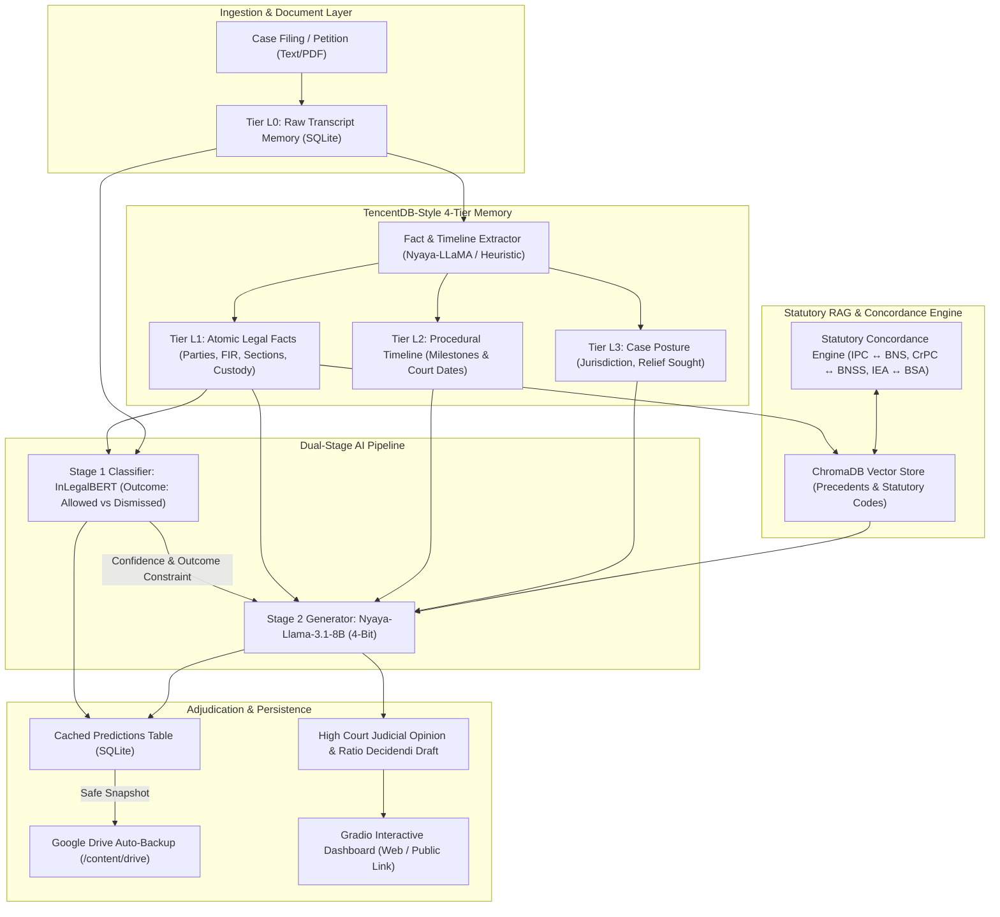

# ⚖️ Indian Legal Judgment Prediction & 4-Tier Memory Engine

An end-to-end, dual-stage judicial outcome prediction and reasoning pipeline designed specifically for the Indian legal ecosystem. Optimized to execute within the resource limits of **Google Colab Free Tier (15 GB T4 GPU)** as well as local environments.

---

## 🏛️ System Architecture



---

## 🚀 Key Innovations & Architectural Choices

### 1. Dual-Stage Paradigm: Precision First, Reasoning Second
- **Stage 1 (Classification)**: `law-ai/InLegalBERT` fine-tuned on the Indian Legal Documents Corpus (ILDC). Yields high statistical accuracy predicting binary outcome (`PETITION ALLOWED` vs `PETITION DISMISSED`) without generative hallucination.
- **Stage 2 (Judicial Reasoning)**: `Raazi29/Nyaya-Llama-3.1-8B-Indian-Legal` (quantized to 4-bit via BitsAndBytes). Synthesizes extracted case facts, timeline milestones, and retrieved statutory law into a structured ratio decidendi and operative order strictly constrained by Stage 1's prediction.

### 2. Colab Free Tier VRAM Optimization (~8.4 GB Total)
| Component | Model / Engine | VRAM Footprint |
| :--- | :--- | :--- |
| **Stage 1 Classifier** | `law-ai/InLegalBERT` | ~0.44 GB |
| **Stage 2 Generator** | `Nyaya-Llama-3.1-8B` (4-bit NF4) | ~5.20 GB |
| **RAG Embeddings** | `all-MiniLM-L6-v2` | ~0.28 GB |
| **PyTorch Context & KV Cache** | CUDA Overhead | ~2.50 GB |
| **TOTAL** | **Safe Execution on 15 GB T4 GPU** | **~8.42 GB (< 57% VRAM)** |

### 3. TencentDB-Inspired 4-Tier Memory Architecture
- **Tier L0 (Raw Data)**: Complete petition texts, FIR narratives, and dialogue turns.
- **Tier L1 (Atomic Facts)**: Key-value entities: Petitioner, Respondent, FIR No., Police Station, Alleged Sections, Custody Period, Chargesheet Status, and Criminal Antecedents.
- **Tier L2 (Procedural Timeline)**: Chronological order of court and investigative events (Date of FIR, Arrest, Bail Dismissal by Sessions, Filing in High Court).
- **Tier L3 (Persona / Posture)**: Case profile: Representation side, High Court jurisdiction, and targeted relief (Regular Bail u/s 439 CrPC / 483 BNSS, Quashing u/s 482 CrPC / 528 BNSS).

### 4. Statutory Concordance Engine (July 2024 Transition)
India enacted a major criminal justice overhaul on July 1, 2024. This engine cross-references historical statutes with new provisions automatically:
- **IPC 1860 $\leftrightarrow$ BNS 2023** (e.g., Section 302 $\leftrightarrow$ Section 103(1); Section 420 $\leftrightarrow$ Section 318(4))
- **CrPC 1973 $\leftrightarrow$ BNSS 2023** (e.g., Section 438 $\leftrightarrow$ Section 482; Section 439 $\leftrightarrow$ Section 483; Section 482 $\leftrightarrow$ Section 528)
- **IEA 1872 $\leftrightarrow$ BSA 2023** (e.g., Section 27 $\leftrightarrow$ Section 23; Section 65B $\leftrightarrow$ Section 63)

### 5. FUSE-Safe Google Drive Backup
Directly writing SQLite transactions over Google Drive (`/content/drive`) causes lock errors and high network latency. This architecture runs all SQLite and ChromaDB operations on the local Colab NVMe (`/content/legal_runtime/`) with a safe `wal_checkpoint(TRUNCATE)` sync to Google Drive.

---

## 💻 Quickstart on Google Colab (One-Click)

1. Open [Google Colab](https://colab.research.google.com/).
2. Upload the notebook from `notebooks/legal_judgment_prediction_colab.ipynb`.
3. Set runtime to **GPU (T4)**: `Runtime > Change runtime type > T4 GPU`.
4. Run all cells. The final cell will launch the interactive Gradio dashboard and provide a public shareable URL (`https://xxxx.gradio.live`).

---

## 🛠️ Local Workstation Installation

```bash
# 1. Clone or navigate to the repository
cd "muhsina judgement prediction"

# 2. Create virtual environment
python -m venv venv
venv\Scripts\activate   # On Windows
# source venv/bin/activate # On Linux/macOS

# 3. Install dependencies
pip install -r requirements.txt

# 4. Run automated test suite
python -m unittest discover tests

# 5. Launch the interactive dashboard
python app.py
```

---

## 📁 Repository Structure

```
muhsina judgement prediction/
├── config.py                 # Paths, models, Colab/local auto-detection
├── pipeline.py               # Unified legal judgment orchestrator
├── app.py                    # Gradio web dashboard (UI)
├── requirements.txt          # Python dependencies
├── README.md                 # Architecture documentation
├── memory/
│   ├── sqlite_memory.py      # 4-tier TencentDB-style SQLite manager & Drive backup
│   └── fact_extractor.py     # L1 facts & L2 timeline extractor
├── rag/
│   ├── concordance.py        # IPC <-> BNS, CrPC <-> BNSS concordance dictionary
│   └── vector_store.py       # ChromaDB legal vector store with statutory indexing
├── models/
│   ├── classifier.py         # Stage 1 InLegalBERT outcome classifier
│   └── reasoning_engine.py   # Stage 2 4-Bit Nyaya-LLaMA judicial reasoning generator
├── notebooks/
│   └── legal_judgment_prediction_colab.ipynb # Ready-to-run Colab Notebook
└── tests/
    └── test_pipeline.py      # Automated unit and integration test suite
```
