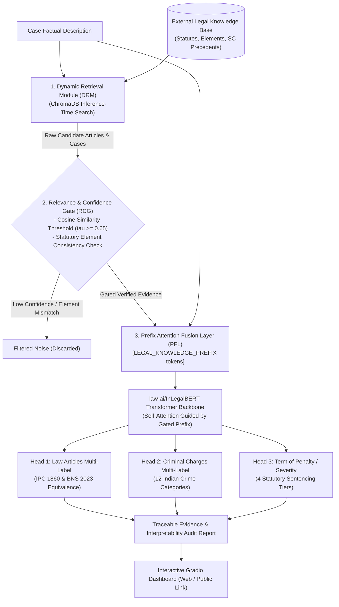

# ⚖️ Dynamic Legal Knowledge Retrieval for Judgment Prediction (DLKR-LJP)

A research-grade implementation of the paper:
> **"Dynamic Legal Knowledge Retrieval for Judgment Prediction"**  
> Adapted to the Indian Criminal Legal System (IPC 1860 & BNS 2023) using `law-ai/InLegalBERT`.

---

## 🔬 Abstract Overview & Architecture



---

## 🚀 Key Modules & Novel Innovations

### 1. Dynamic Retrieval Module (DRM)
Unlike static classifiers that memorize training sets, the DRM dynamically fetches relevant law articles, essential legal ingredients (e.g. *Mens Rea*, entrustment, bodily injury), and landmark prior cases at inference time from an external knowledge base.

### 2. Relevance and Confidence Gate (RCG)
To solve the noise problem in dense retrieval, RCG applies a dual-metric gate:
- **Semantic Confidence Cutoff**: Drops candidates with cosine similarity below $\tau = 0.65$.
- **Legal Element Consistency Check**: Verifies that the factual text actually substantiates the core ingredients of the crime (e.g., rejects murder candidates if no death or physical violence is present in a financial fraud case).

### 3. Prefix-Based Attention Knowledge Fusion (PFL)
The verified gated knowledge is formatted into specialized attention prefix tokens:
$$\mathbf{P} = [\text{PREFIX\_START}], p_1, p_2, \dots, p_M, [\text{PREFIX\_END}]$$
which are prepended to the case tokens entering `law-ai/InLegalBERT`. Every token in the factual description attends to the external legal knowledge tokens via transformer multi-head self-attention.

### 4. 3-Head Multi-Task Prediction Network
1. **Head 1 (Law Articles)**: Predicts applicable sections with dual-statute cross-referencing between historical provisions (IPC) and new provisions (BNS 2023).
2. **Head 2 (Criminal Charges)**: Classifies offences into standardized Indian criminal categories.
3. **Head 3 (Penalty Severity Tiers)**: Predicts statutory sentencing severity:
   - **Tier 1**: Up to 3 Years (Bailable)
   - **Tier 2**: 3 to 7 Years (*Arnesh Kumar* Notice Threshold)
   - **Tier 3**: 7 to 10 Years (Non-Bailable Warrant)
   - **Tier 4**: Life Imprisonment or Capital Punishment

---

## 💻 Google Colab Quickstart (One-Click)

1. Open [Google Colab](https://colab.research.google.com/).
2. Upload `notebooks/dynamic_ljp_colab.ipynb`.
3. Set runtime to **T4 GPU** (`Runtime > Change runtime type > T4 GPU`).
4. Drag and drop `dynamic_legal_retrieval_ljp.zip` into the Colab Files tab.
5. Click **Runtime > Run all** to launch the interactive Gradio dashboard with a public URL!

---

## 🛠️ Local Workstation Setup

```bash
# 1. Navigate to project folder
cd dynamic_legal_retrieval_ljp

# 2. Create virtual environment
python -m venv venv
venv\Scripts\activate   # On Windows
# source venv/bin/activate # On Linux/macOS

# 3. Install requirements
pip install -r requirements.txt

# 4. Run automated test suite
python -m unittest discover tests

# 5. Launch dashboard
python app.py
```

Open browser at `http://localhost:7861`.
